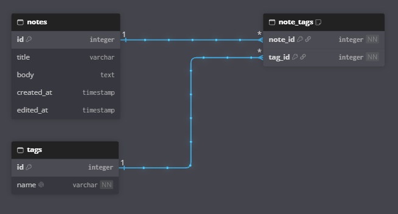

# Персональная база знаний noteBase
Веб-приложение реализующее функционал добавления и редактирования пользовательских заметок, а также их категоризацию (присвоение тегов).

## Описание сущностей и связей
Каждой заметке может быть присвоено от нуля до нескольких тегов. Теги могут существовать без заметок, и наоборот. При удалении тега - он пропадает с существующих заметок. Удалении заметки не влияет на тег. Имена тегов регистронезависимы.

> [!NOTE]
> `edited_at` принимает значение `created_at` при создании заметки

## Описание API-эндпоинтов
| Метод | Эндпоинт | Тело запроса | Назначение |
| ----- | -------- | ------------ | ---------- |
| `GET` | `/notes` | Нет | Получение списка заметок |
| `GET` | `/notes/{note_id}` | Нет | Получение одной заметки |
| `POST` | `/notes` | `{"title": "Заголовок", "body": "Текст заметки"}` | Создание заметки |
| `PATCH` | `/notes/{note_id}` | `{"title": "Новый заголовок", "body": "Новый текст"}` | Изменение заметки |
| `DELETE` | `/notes/{note_id}` | Нет |  Удаление заметки |
| `GET` | `/tags` | Нет | Получение списка тегов |
| `GET` | `/tags/{tag_id}` | Нет | Получение одного тега |
| `POST` | `/tags` | `{"name": "работа"}` | Создание тега |
| `PATCH` | `/tags/{tag_id}` | `{"name": "работа"}` | Изменение тега |
| `DELETE` | `/tags/{tag_id}` | Нет | Удаление тега |
| `POST` | `/notes/{note_id}/tags` | `{"tag_ids": [1, 2]}` | Добавление тегов к заметке |
| `DELETE` | `/notes/{note_id}/tags/{tag_id}` | Нет | Удаление тега с заметки |
